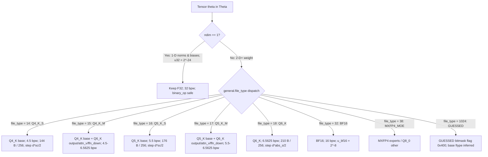

<!-- SPDX-License-Identifier: MIT -->
<!-- Copyright (c) 2026 Clarke Yoursa Tee (AxiomicCoreness) -->
<!-- Zenodo DOI: 10.5281/zenodo.23378305 (https://doi.org/10.5281/zenodo.23378305) -->
<!-- DeepInfer model design is by Clarke Yoursa Tee -->

# K-Quant Block Algebra and 1-D $\mathbb{F}_{32}$ Rule

Mathematical specification of `llama.cpp` / `ggml` K-quant superblock reconstruction, error bounds, the 1-D $\mathbb{F}_{32}$ stability rule, `Q4_K_M` tensor routing, and measured byte anchors for **DI-66L**.

---

## §1 Tensor Partition and K-Quant Block Algebra

Let the model parameter set partition into two disjoint tensor classes:

$$\Theta = \Theta_{2\text{d}} \sqcup \Theta_{1\text{d}}$$

where $\Theta_{2\text{d}}$ comprises tensors with `ndim >= 2` (linear projections, MoE experts, embeddings, output head) eligible for block quantization, and $\Theta_{1\text{d}}$ comprises 1-D tensors (`ndim == 1`: RMSNorm weights `*_norm.weight` and attention `q/k/v` biases) kept unquantized in $\mathbb{F}_{32}$.

Each quantized weight row in $\Theta_{2\text{d}}$ is partitioned into superblocks $B_b$ of length $|B_b| = QK\_K = 256$ (`ggml-common.h`). Only the superblock scales $d_b$ and $d^{\min}_b$ are stored in $\mathbb{F}_{16}$ (`ggml_half`); sub-block scales and mins are integer-quantized.

### 1.1 `Q6_K` (16 sub-blocks of 16 weights)

- **Sub-block geometry:** 16 sub-blocks $S_{b,s}$ of size $|S_{b,s}| = 16$ ($s \in \{0, \dots, 15\}$).
- **Reconstruction:** for local weight index $j \in \{0, \dots, 255\}$,

$$\widehat{W}_j = d_b \cdot s_{b,\lfloor j/16 \rfloor} \cdot (q_j - 32), \qquad q_j \in [0, 63]$$

- **Storage layout (`block_q6_K`):**
  - `ql`: $QK\_K / 2 = 128\text{ B}$ (lower 4 bits of $q_j$)
  - `qh`: $QK\_K / 4 = 64\text{ B}$ (upper 2 bits of $q_j$)
  - `scales`: $QK\_K / 16 = 16\text{ B}$ (signed 8-bit integer sub-block scales $s_{b,s} \in [-128, 127]$)
  - `d`: $2\text{ B}$ (superblock scale $d_b \in \mathbb{F}_{16}$)
- **Bit rate:** $128 + 64 + 16 + 2 = 210\text{ B}$ per $256$ weights $\implies 210 \times 8 / 256 = 6.5625\text{ bpw}$.

### 1.2 `Q4_K` (8 sub-blocks of 32 weights)

- **Sub-block geometry:** 8 sub-blocks $S_{b,s}$ of size $|S_{b,s}| = 32$ ($s \in \{0, \dots, 7\}$).
- **Reconstruction:** for local weight index $j \in \{0, \dots, 255\}$,

$$\widehat{W}_j = d_b \cdot sc_{b,\lfloor j/32 \rfloor} \cdot q_j - d^{\min}_b \cdot m_{b,\lfloor j/32 \rfloor}, \qquad q_j \in [0, 15]$$

- **Storage layout (`block_q4_K`):**
  - `d`, `dmin`: $2 + 2 = 4\text{ B}$ (superblock scale $d_b \in \mathbb{F}_{16}$ and superblock min $d^{\min}_b \in \mathbb{F}_{16}$)
  - `scales`: $K\_SCALE\_SIZE = 12\text{ B}$ (eight 6-bit unsigned integer scales $sc_{b,s} \in [0, 63]$ and eight 6-bit unsigned integer mins $m_{b,s} \in [0, 63]$ packed via `get_scale_min_k4`)
  - `qs`: $QK\_K / 2 = 128\text{ B}$ (4-bit nibbles $q_j$)
- **Bit rate:** $4 + 12 + 128 = 144\text{ B}$ per $256$ weights $\implies 144 \times 8 / 256 = 4.5\text{ bpw}$.

### 1.3 `Q5_K` (8 sub-blocks of 32 weights)

- **Sub-block geometry:** 8 sub-blocks $S_{b,s}$ of size $|S_{b,s}| = 32$ ($s \in \{0, \dots, 7\}$), sharing the `Q4_K` affine scale/min structure.
- **Reconstruction:** for local weight index $j \in \{0, \dots, 255\}$,

$$\widehat{W}_j = d_b \cdot sc_{b,\lfloor j/32 \rfloor} \cdot q_j - d^{\min}_b \cdot m_{b,\lfloor j/32 \rfloor}, \qquad q_j \in [0, 31]$$

- **Storage layout (`block_q5_K`):**
  - `d`, `dmin`: $2 + 2 = 4\text{ B}$ ($d_b, d^{\min}_b \in \mathbb{F}_{16}$)
  - `scales`: $12\text{ B}$ (6-bit integer $sc_{b,s}, m_{b,s} \in [0, 63]$)
  - `qh`: $QK\_K / 8 = 32\text{ B}$ (high 5th bit of $q_j$)
  - `qs`: $QK\_K / 2 = 128\text{ B}$ (low 4 bits of $q_j$)
- **Bit rate:** $4 + 12 + 32 + 128 = 176\text{ B}$ per $256$ weights $\implies 176 \times 8 / 256 = 5.5\text{ bpw}$.

| Type | Sub-blocks $\times$ Size | Integer $q_j$ | Sub-block Scales | Superblock Scale(s) | Bytes / 256 | bpw |
|---|---:|---:|---|---|---:|---:|
| `Q4_K` | $8 \times 32$ | $[0, 15]$ | $sc, m$ 6-bit uint (`12 B`) | $d, d^{\min} \in \mathbb{F}_{16}$ (`4 B`) | `144` | `4.5` |
| `Q5_K` | $8 \times 32$ | $[0, 31]$ (`qs` + `qh`) | $sc, m$ 6-bit uint (`12 B`) | $d, d^{\min} \in \mathbb{F}_{16}$ (`4 B`) | `176` | `5.5` |
| `Q6_K` | $16 \times 16$ | $[0, 63]$ (`ql` + `qh`) | $s$ 8-bit int (`16 B`) | $d \in \mathbb{F}_{16}$ (`2 B`) | `210` | `6.5625` |

---

## §2 Error Geometry

Within sub-block $(b, s)$ having effective step $\Delta_{b,s}$ ($\Delta_{b,s} = d_b \cdot sc_{b,s}$ for `Q4_K`/`Q5_K`; $\Delta_{b,s} = d_b \cdot |s_{b,s}|$ for `Q6_K`), uniform nearest-grid quantization over the sub-block dynamic range satisfies:

$$\left|\widehat{W}_j - W_j\right| \le \frac{1}{2}\,\Delta_{b,s}$$

For floating-point parameters in $\Theta_{1\text{d}}$ (norm weights, biases) and superblock scales, IEEE-754 round-to-nearest-even has unit roundoff $u = 2^{-p}$ (significand precision $p$ including the implicit bit):

$$u_{16} = 2^{-11} \approx 4.8828 \times 10^{-4} \quad (\mathbb{F}_{16}), \qquad u_{32} = 2^{-24} \approx 5.9605 \times 10^{-8} \quad (\mathbb{F}_{32})$$

Promoting $\Theta_{1\text{d}}$ from $\mathbb{F}_{16}$ to $\mathbb{F}_{32}$ reduces per-element relative rounding error by $u_{16} / u_{32} = 2^{13} = 8{,}192\times$.

---

## §3 1-D $\mathbb{F}_{32}$ Rule, `ggml` Binary-Op Constraint, and `Q4_K_M` Routing

### 3.1 Multiplicative Chain Across $L$ Layers

Each transformer layer applies RMSNorm weights multiplicatively to the residual/attention/FFN stream. If layer $l \in \{1, \dots, L\}$ incurs a relative scale perturbation $\delta_l$ with $|\delta_l| \le \varepsilon$, the cumulative multiplicative drift over $L$ layers satisfies the exact worst-case bound:

$$\prod_{l=1}^{L} (1 + \delta_l) - 1 \le (1 + \varepsilon)^L - 1$$

For $L\varepsilon \ll 1$, $(1 + \varepsilon)^L - 1 \approx L\varepsilon$ holds **only to first order**; the exact bound is $(1 + \varepsilon)^L - 1$. Keeping $\Theta_{1\text{d}}$ in $\mathbb{F}_{32}$ shrinks $\varepsilon$ from $2^{-11}$ to $2^{-24}$ (a $2^{13}$ reduction in per-scale relative error) at $< 1\%$ byte overhead: on **DI-66L** ($L = 66$), promoting all $331$ 1-D tensors (`*_norm.weight` and `attn_{q,k,v}.bias`) from $\mathbb{F}_{16}$ to $\mathbb{F}_{32}$ adds $+678,912$ bytes ($\approx 0.027\%$ of the $2.48\text{ GB}$ `Q5_K_S` artifact and $\approx 0.033\%$ of the $2.08\text{ GB}$ `Q4_K_S` artifact).

### 3.2 `ggml` CPU Binary-Op Constraint

In `ggml/src/ggml-cpu/binary-ops.cpp` (`binary_op<op>`), elementwise `mul`/`add` dispatches only over `(F32, F32 -> F32)`, `(F16, F16 -> F16)`, `(BF16, BF16 -> BF16)`, `(BF16, F32 -> BF16|F32)`, and `(F16, F32 -> F16|F32)`. When `src0` is `F32` (hidden activations) and `src1` is `F16` (a 1-D norm weight or bias) with `dst` `F32`, CPU execution aborts with:

```text
binary_op: unsupported types: dst: f32, src0: f32, src1: f16
```

Keeping $\Theta_{1\text{d}}$ in $\mathbb{F}_{32}$ satisfies both the numerical precision bound and the `ggml-cpu` runtime type contract.

### 3.3 `Q4_K_M` Tensor Routing (`llama.cpp` `llama_tensor_get_type`)

Verified against `tensor_allows_quantization`, `llama_tensor_get_type`, and `llama_tensor_get_type_impl` in `src/llama-quant.cpp`:

1. **1-D & unquantizable exclusion:** `tensor_allows_quantization` returns `false` for `ggml_n_dims(tensor) < 2`, `*_norm.weight`, `ffn_gate_inp.weight`, and small routing/conv tensors, leaving $\Theta_{1\text{d}}$ at `F32`.
2. **`output.weight` $\to$ `Q6_K`:** tensors in `tensor_category::OUTPUT` promote to `Q6_K` (except `LLAMA_FTYPE_MOSTLY_MXFP4_MOE`, `LLM_ARCH_FALCON`, or `nx % qk_k != 0`, which use `Q8_0`; and ultra-low IQ types, which use `Q5_K`).
3. **`token_embd.weight` stays base type (`Q4_K`):** untied `TOKEN_EMBD` is **not** promoted to `Q6_K` under `Q4_K_M`—it remains at `default_type = Q4_K` unless `qs.has_tied_embeddings` is true (or `--token-embedding-type` is explicitly overridden).
4. **`ATTN_V` and `FFN_DOWN` mixing:** under `Q4_K_M` (and `Q5_K_M`), `category_is_attn_v` and `FFN_DOWN` (non-Falcon) promote to `Q6_K` whenever `use_more_bits(i_layer, n_layers)` holds:

   $$i < \lfloor n / 8 \rfloor \quad \lor \quad i \ge \lfloor 7n / 8 \rfloor \quad \lor \quad \big(i - \lfloor n / 8 \rfloor\big) \bmod 3 = 2$$

   and stay at the base type (`Q4_K` / `Q5_K`) otherwise.
5. **Other `Q4_K_M` promotions:** `ATTENTION_QKV` promotes to `Q5_K` under `Q4_K_M` (and `Q6_K` under `Q5_K_M`); `ATTENTION_OUTPUT` promotes to `Q5_K` under `Q4_K_M` when `n_expert == 8`.

---

## §4 `file_type` Dispatch Flowchart (`enum llama_ftype`)

`general.file_type` IDs verified against `enum llama_ftype` in `include/llama.h`: `Q4_K_S=14`, `Q4_K_M=15`, `Q5_K_S=16`, `Q5_K_M=17`, `Q6_K=18`, `BF16=32`, `MXFP4_MOE=38`, `GUESSED=1024`.



---

## §5 Measured Byte Anchors (Real Data Only)

Digest verification follows the runbook discipline in [`docs/DEEPINFER_8090_RUNBOOK.md`](DEEPINFER_8090_RUNBOOK.md) (which pins `deepseek-r2-1.5b-Q4_K_M.gguf` at `1,117,320,640` bytes with SHA-256 `80a49c2fe2410f704ceda4590212174a99899341b01e6af5433319481179e5c1`). Full SHA-256 digests for the **DI-66L** `/work/out` artifacts are pending computation and are intentionally omitted here rather than invented.

| Artifact | `file_type` | Size (bytes) | Tensor Layout & Verification | SHA-256 |
|---|---:|---:|---|---|
| `DeepInfer-66L-from198-Q4_K_S-f32norm.gguf` | `14` (`Q4_K_S`) | `2,081,222,304` | 331 `F32` 1-D tensors; 2-D `Q4_K`/`Q5_K` mix | pending |
| `DI-66L-from198-ink-Q5_K_S-f32norm.gguf` | `16` (`Q5_K_S`) | `2,482,474,656` | 795 tensors: 463 `Q5_K` + 1 `Q6_K` + 331 `F32` | pending |
| `DI-66L-from198-ink-Q6K-f32norm.gguf` | `18` (`Q6_K`) | `2,923,636,896` | 795 tensors: 464 `Q6_K` + 331 `F32`; `block_count = 66` | pending |

- **1-D $\mathbb{F}_{32}$ delta on DI-66L:** promoting 331 1-D tensors from $\mathbb{F}_{16}$ to $\mathbb{F}_{32}$ adds `678,912` bytes.
- **`Q5_K` $\to$ `Q6_K` conversion check (`DI-66L-from198-ink-Q6K-f32norm.gguf`, 7-tensor sample):** `max_abs = 6.608963e-03`, `worst rms_rel = 1.950753e-02`, `0` NaN/Inf values.

### Note for Future Upkeep Runner

An automated upkeep workflow (not yet enabled) could mount or inspect GGUF headers to:
1. Recompute §5 byte counts and tensor dtype histograms (`463 Q5_K + 1 Q6_K + 331 F32`, `464 Q6_K + 331 F32`, etc.) directly from GGUF metadata.
2. Fill and assert full `sha256sum` pairs matching `docs/DEEPINFER_8090_RUNBOOK.md`.
