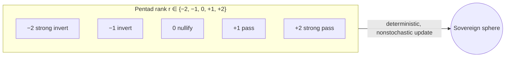

# Pentad rank

The Port-380 FAL gate uses a balanced five-level rank r ∈ {−2, −1, 0, +1, +2}.
Implemented at `fe9fc38` in `quantum/radar_lindblad/port_380_gate.py`, the
local fallback in `quantum/deepseek_mesh/endpoint.py`, and
`quantum/cdp_convergence/cdp_schema.py`. Tests: `tests/test_port380_pentad.py`.

The gate is dynamic, deterministic and nonstochastic: the same rank and harmony
always give the same output.

| r | mode | harmony out |
|---|------|-------------|
| −2 | strong_invert | −2·h |
| −1 | invert | −h |
| 0 | nullify | 0 |
| +1 | identity | h |
| +2 | strong_identity | 2·h |

- −1, 0, +1 behave exactly as before.
- ±2 only comes from an explicit override: `--ternary`/`--pentad` on the CLI,
  `"ternary"` in the `POST /gate` body, or the function argument. CDP/OAuth
  derivation still yields only −1, 0 or +1.
- `POST /gate` returns 400 outside −2..2 and 422 for non-integers.
  `/status`, `/380` and `/` list the allowed values as `fal_allowed`.
- Still ternary: the BitNet b1.58 weights in `quantum/port_380_implicit.py` and
  the sealed entries 8213 and 8224.

